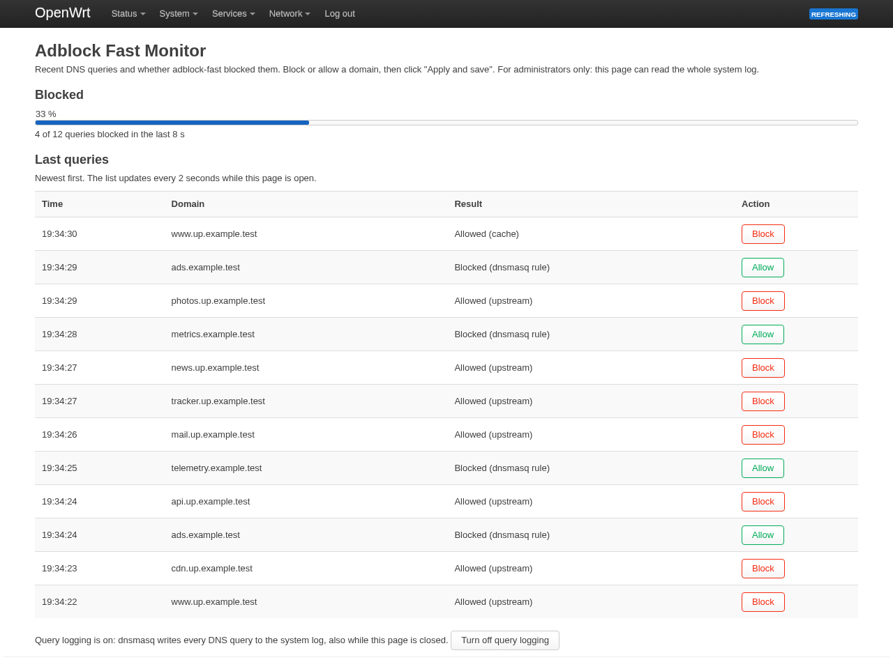
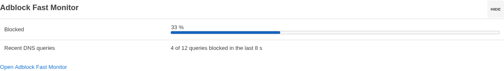
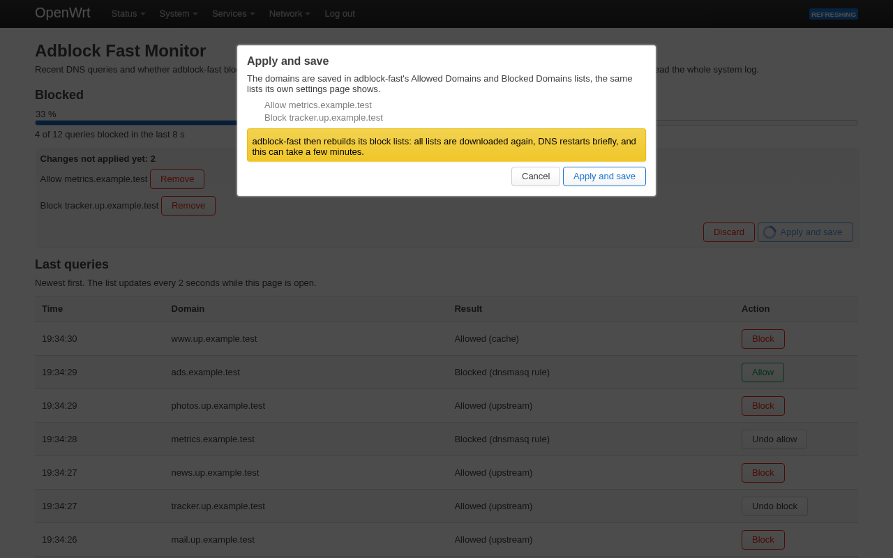

# Adblock Fast Monitor

A small LuCI page for OpenWrt that shows the DNS queries your router just
answered, which ones [adblock-fast](https://github.com/openwrt/packages/tree/master/net/adblock-fast)
blocked, and lets you allow or block a name with one click.

> **Status:** no release is published yet, so the package feed below is not
> live yet. Until then, build the package yourself
> ([developer guide](CONTRIBUTING.md)) and install it over SSH with
> `apk add --allow-untrusted`.



## What you get

- **Blocked %** of the recent queries, also on **Status → Overview**:

  

- **Recent queries:** time, name, and whether adblock-fast blocked or
  allowed each one. The list updates by itself.
- **Block / Allow** on every row. Changes wait in a bar until you press
  **Apply and save**, so ten changes cost one rebuild, not ten. They go into
  adblock-fast's own **Allowed Domains** and **Blocked Domains** lists, so
  adblock-fast's page shows them too.



It needs OpenWrt 25.12 and adblock-fast. It is its own package: it does not
change or copy adblock-fast.

## How to use

1. **Add the signing key.** In LuCI open **System → Administration →
   Repository Public Keys**, paste
   `https://leandrosq.github.io/adblock-fast-monitor/keys/adblock-fast-monitor.pem`
   and click **Add key**. (To check it first, compare its fingerprint with
   the one in [`keys/README.md`](keys/README.md).)
2. **Add the feed.** In **System → Software → Configure apk**, add
   `https://leandrosq.github.io/adblock-fast-monitor/apk/packages.adb` to
   `customfeeds.list` and click **Save**.
3. **Install.** In **System → Software**, click **Update lists…**, search
   for `luci-app-adblock-fast-monitor` and click **Install…**.
4. **Turn on logging.** Open **Services → Adblock Fast Monitor** and click
   **Turn on query logging**. (If dnsmasq already logs queries, the page
   says so and you can skip this.)
5. **Watch.** New queries show up every 2 seconds while the page is open.
   **Status → Overview** shows the blocked share too.
6. **Change rules.** Click **Block** on an allowed name or **Allow** on a
   blocked one. Click **Undo** to take it back.
7. **Apply and save.** Click **Apply and save**, then confirm. adblock-fast
   rebuilds its lists once, and the page checks each name with a real DNS
   lookup.

Updates appear later under **System → Software → Updates**.

## How it works

```text
 your browser ──"read the system log"──▶ router (logd)
      │                                      ▲
      │ parses the lines, draws the list     │ dnsmasq writes one line per query
      │                                      │
      └── Apply and save ──▶ adblock-fast's Allowed/Blocked Domains,
                             then one rebuild of its lists
```

**Turn on query logging** tells dnsmasq to write each query to the
router's system log. The page asks for the newest log lines every 2 seconds,
the same way LuCI's System Log page does, and does all the reading and
counting in your browser. Nothing of this package runs in the background on
the router. When you press **Apply and save**, your changes are saved in
adblock-fast's own **Allowed Domains** and **Blocked Domains** lists and
adblock-fast rebuilds its block list once, as its own **Redownload** button
does. (adblock-fast's **Save & Apply** alone does not rebuild the lists.)

## Resource usage

Measured on an emulated ARM router (OpenWrt in QEMU, hardware-accelerated
on a fast Mac), not on real router hardware. A real router is slower, so
treat the times as relative, not absolute.

| What | Result |
| --- | --- |
| Background processes | none |
| Requests while the tab is hidden or closed (also Status → Overview) | 0 |
| Extra router CPU while the page is open | about 0 (lost in the noise) |
| Extra DNS delay | 0.1 ms or less |
| Router memory | about 200 KB, inside rpcd |
| Query logging itself (dnsmasq's own feature) | dnsmasq +0.5 to +1.7 % and logd +0.3 to +1.1 % of one CPU, at 50 to 200 queries per second |
| One page update, in the browser | about 13 ms |

The only real cost is query logging, and it is dnsmasq's, not this
package's: turning it on by hand costs the same. Details and method:
[`docs/performance.md`](docs/performance.md).

## Limitations

- **Short history.** Queries share the router's in-memory log (128 KiB by
  default, a few hundred queries) with everything else. The page shows how
  far back it reaches and how many lines it missed. To keep more, raise
  **System → System → Logging → System log buffer size**.
- **dnsmasq only.** In adblock-fast's `ipset`/`nftset` modes blocking
  happens in the firewall, so the page shows those names as allowed.
  smartdns and unbound are not supported.
- **Apply takes a while.** A rebuild downloads adblock-fast's lists again;
  it takes as long as adblock-fast needs.
- **Only the newest 50 queries** are listed, newest first, and queries made
  by the router itself (`127.0.0.1`, `::1`) are never listed or counted.

## Privacy: admins only

- To show queries, the page reads the **whole system log**, which also
  holds other messages and every client's address. Give access to this app
  only to people who may read the system log, as you would for LuCI's
  System Log page.
- With logging on, every DNS query and the client's address go to the
  system log. If your log is also saved to a file or sent to another
  server, the queries go there too; the page warns you.
- Nothing about your clients is stored on the router, and the page shows
  no client addresses. Changes you have not applied (domain names only)
  stay in your browser until you apply or discard them.

## Uninstall

**System → Software → Installed →** `luci-app-adblock-fast-monitor` **→
Remove…**. Removal turns query logging off again. Rules you applied stay
in adblock-fast; manage them in its own page. To drop the feed, remove its
line from `customfeeds.list` and the key from Repository Public Keys.

## More

- [Developer guide](CONTRIBUTING.md) and [rules for contributors](AGENTS.md)
- [All documentation](docs/README.md): testing, releasing, design, the
  interface contract and performance
- [Changelog](CHANGELOG.md) · [Security](SECURITY.md)

Copyright 2026 LeandroSQ and contributors, [Apache License 2.0](LICENSE).
An independent project, not affiliated with OpenWrt or the adblock-fast
authors.
